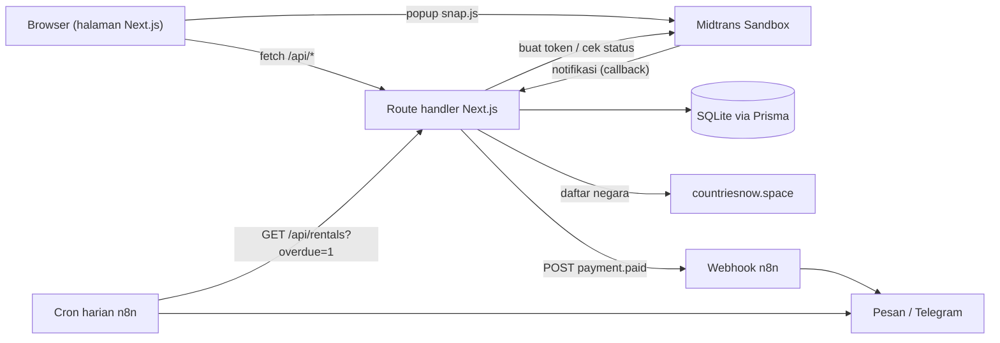
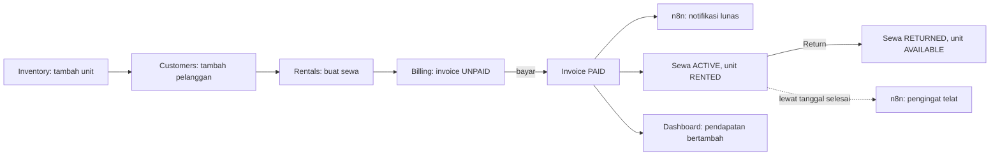
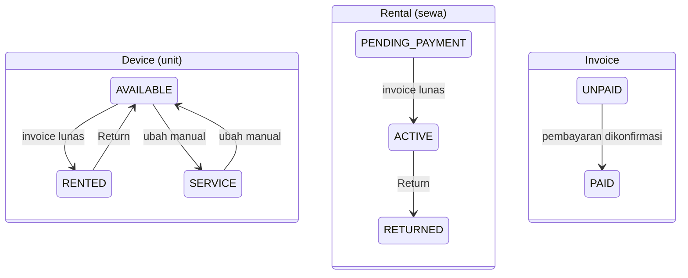
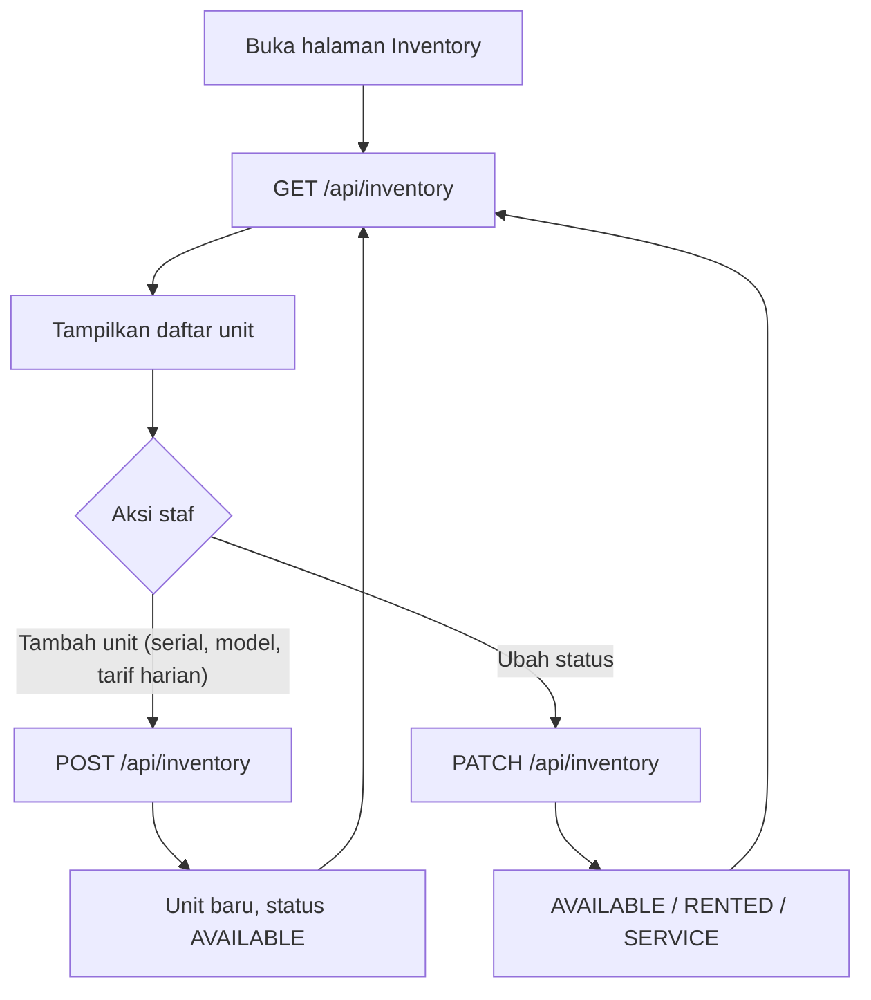
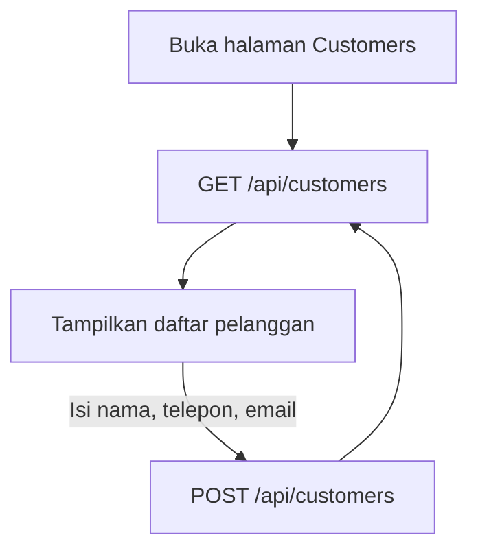
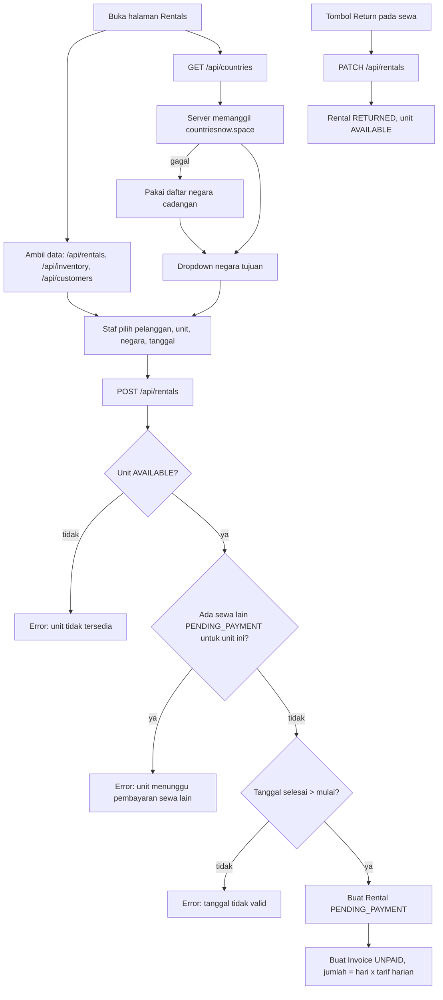
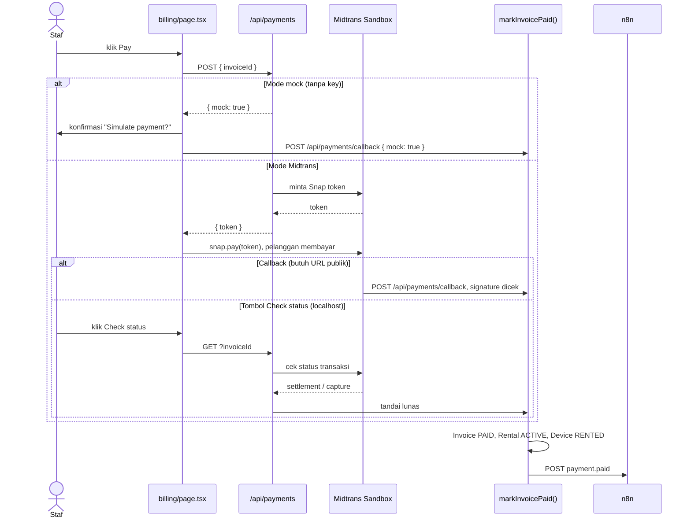
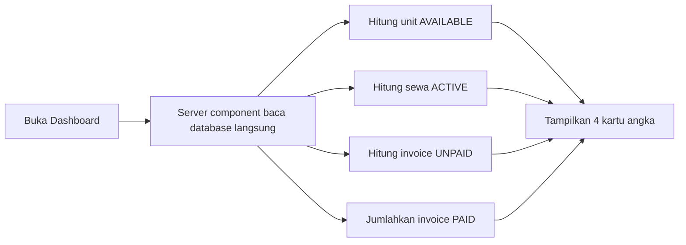
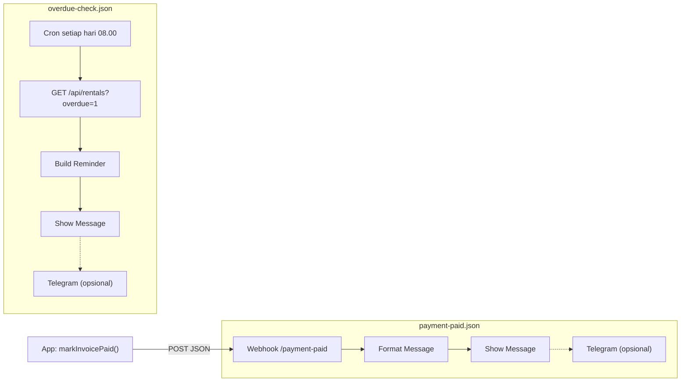

# JavaMifi ERP - Rental MiFi

Aplikasi ERP sederhana untuk bisnis penyewaan modem MiFi portabel (untuk traveler, tema JavaMifi).
Staf dapat menambah unit dan pelanggan, membuat order sewa, menagih lewat Midtrans, lalu n8n mengirim notifikasi.

## Fitur per modul

| Modul | Fungsi |
|---|---|
| Dashboard | Jumlah unit tersedia, sewa aktif, invoice belum dibayar, total pendapatan |
| Inventory | Daftar unit, tambah unit, ubah status (AVAILABLE / RENTED / SERVICE) |
| Customers | Daftar dan tambah pelanggan |
| Rentals | Buat order sewa (pelanggan, unit tersedia, negara tujuan, tanggal). Invoice dibuat otomatis (jumlah hari x tarif harian). Tombol "Return" mengubah sewa jadi RETURNED dan unit kembali AVAILABLE |
| Billing | Daftar invoice, tombol **Pay** (Midtrans Snap) dan **Check status** |

## Tiga poin wajib

1. **API connection**
   - REST API internal: route handler Next.js di `app/api/*`. Halaman-halaman memanggilnya dengan `fetch`.
   - API eksternal: `app/api/countries/route.ts` mengambil daftar negara dari `countriesnow.space` (di sisi server, di-cache 1 hari, ada daftar cadangan jika API sedang mati) untuk dropdown negara tujuan.
2. **Payment gateway**: Midtrans Sandbox (Snap), memakai `fetch` biasa tanpa SDK (`lib/midtrans.ts`).
   Tanpa key, aplikasi berjalan dalam **mode MOCK** (muncul konfirmasi "Simulate payment?"), jadi demo tetap bisa jalan di mana saja.
3. **Otomasi n8n** (workflow di folder `n8n/`)
   - `payment-paid.json`: webhook, lalu memformat pesan. Dipicu oleh aplikasi saat invoice lunas.
   - `overdue-check.json`: cron harian jam 08.00, memanggil `GET /api/rentals?overdue=1`, lalu menyusun pesan pengingat.
   - Keduanya berakhir di node output biasa dan punya node Telegram yang **dinonaktifkan** (opsional).

## Tech stack

Next.js (App Router) + TypeScript + Tailwind, Prisma + SQLite, Midtrans Snap sandbox, n8n.

## Instalasi dan menjalankan

```bash
npm install
cp .env.example .env      # key kosong = mode pembayaran mock
npm run db:setup          # membuat database SQLite (prisma db push) dan mengisi data contoh
npm run dev               # http://localhost:3000
```

**n8n (di terminal terpisah):**

```bash
npx n8n                   # http://localhost:5678
```

Di n8n: Workflows > Import from file > pilih `n8n/payment-paid.json`, lalu `n8n/overdue-check.json`.
Buka tiap workflow lalu klik **Execute workflow** (URL test) atau aktifkan **Active** (URL production).
`N8N_WEBHOOK_URL` di `.env` memakai URL production `/webhook/payment-paid`, jadi workflow harus dalam status Active.
Untuk memakai Telegram, aktifkan node Telegram lalu isi kredensial bot dan chat id.

**Midtrans sandbox (opsional):** buat akun sandbox, salin key ke `.env`:

```
MIDTRANS_SERVER_KEY="SB-Mid-server-..."
NEXT_PUBLIC_MIDTRANS_CLIENT_KEY="SB-Mid-client-..."
```

Restart `npm run dev`. Bayar dengan kartu uji Midtrans, lalu klik **Check status**
(Midtrans tidak bisa menjangkau localhost, jadi tombol ini menanyakan status langsung ke Midtrans). Untuk callback asli,
ekspos aplikasi ke publik (misalnya dengan ngrok) dan isi notification URL di Midtrans dengan `<public-url>/api/payments/callback`.

## Arsitektur



## Flow per modul

### Gambaran besar

Satu siklus bisnis: unit didaftarkan, disewa, dibayar, lalu dikembalikan.



### Status data



### Inventory



### Customers



### Rentals



### Billing (pembayaran)



### Dashboard



### Otomasi n8n



## Alur kode: dari klik "Pay" sampai notifikasi n8n

1. `app/billing/page.tsx` - `pay()` memanggil `POST /api/payments` dengan id invoice.
2. `app/api/payments/route.ts` - membaca invoice, membuat order id `INV-{id}-{timestamp}`, meminta token lewat `createSnapToken()`, menyimpan order id ke invoice, lalu mengembalikan `{ token }` (atau `{ mock: true }` di mode mock).
3. `lib/midtrans.ts` - `createSnapToken()` mengirim POST ke API Midtrans Snap sandbox.
4. `app/billing/page.tsx` - memuat `snap.js` dan memanggil `window.snap.pay(token)`. Pelanggan membayar di popup. (Mode mock: `confirm("Simulate payment?")` lalu memanggil route callback dengan `mock: true`.)
5. Pembayaran dikonfirmasi lewat salah satu dari dua jalur, keduanya berakhir di fungsi yang sama:
   - `app/api/payments/callback/route.ts` - notifikasi Midtrans, signature diverifikasi, status `settlement` atau `capture`.
   - `app/api/payments/route.ts` (GET) - tombol "Check status", bertanya lewat `getTransactionStatus()` di `lib/midtrans.ts`.
6. `lib/midtrans.ts` - `markInvoicePaid()`: invoice jadi PAID + `paidAt`, sewa jadi ACTIVE, unit jadi RENTED, lalu `notifyN8n("payment.paid", ...)`.
7. `lib/n8n.ts` - `notifyN8n()` mengirim POST JSON ke `N8N_WEBHOOK_URL` (tidak pernah melempar error).
8. `n8n/payment-paid.json` - Webhook, Format Message, Show Message (Telegram opsional).

## Struktur folder

```
app/
  layout.tsx, page.tsx            navigasi + dashboard (server component)
  nav-link.tsx                    link sidebar yang menandai halaman aktif
  inventory/page.tsx              daftar/tambah/ubah status unit
  customers/page.tsx              daftar/tambah pelanggan
  rentals/page.tsx                buat sewa, return, dropdown negara
  billing/page.tsx                invoice, Pay, Check status
  api/inventory/route.ts          GET, POST, PATCH (status)
  api/customers/route.ts          GET, POST
  api/rentals/route.ts            GET (?overdue=1 untuk n8n), POST (sekaligus membuat invoice), PATCH (return)
  api/invoices/route.ts           GET invoice untuk halaman Billing
  api/countries/route.ts          GET daftar negara (proxy API eksternal)
  api/payments/route.ts           POST mulai pembayaran, GET cek status
  api/payments/callback/route.ts  notifikasi Midtrans (dan pembayaran mock)
lib/
  db.ts                           Prisma client
  midtrans.ts                     panggilan Midtrans, cek signature, markInvoicePaid()
  n8n.ts                          notifyN8n()
prisma/
  schema.prisma                   Device, Customer, Rental, Invoice
  seed.ts                         data contoh
n8n/
  payment-paid.json               workflow webhook
  overdue-check.json              workflow cron harian
```
